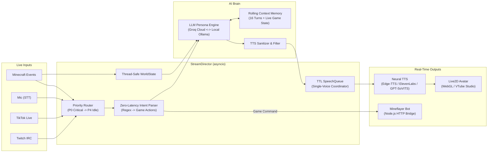

# Luna — Autonomous AI VTuber & Game Agent

An event-driven, real-time AI streamer built in Python (`asyncio`) that ingests multi-platform live chat (Twitch, TikTok, Microphone), routes events through a priority + TTL speech queue, speaks with neural TTS synchronized to a Live2D avatar, and autonomously controls a Minecraft bot via a Node.js Mineflayer bridge.

---

## Instant Interview / Browser Demo (Zero External Setup)

Want to see Luna in action without spinning up VTube Studio, Virtual Audio Cables, Twitch tokens, or a Minecraft server?

**One-click start (Windows):**
```bash
start_demo.bat
```
Or from any terminal:
```bash
pip install -r demo/requirements.txt
python demo/server.py
```

Opens **`http://localhost:8000`** with:
- **Live2D WebGL Avatar** with real-time WebAudio RMS lip-sync, eye-blinking, and mood-driven expressions
- **Interactive Chat & Simulated Viewers** (toggleable Twitch/TikTok crowd)
- **Live Brain Pipeline Inspector** showing real-time priority routing (`P1 direct` vs `P3 batch`), regex intent detection (`0 ms`), LLM latency, and neural TTS synthesis
- **Minecraft Action Toasts** when you give Luna in-game commands (e.g., *"Luna, mine some diamonds"*, *"Luna, protect me from the creepers"*)

---

## System Architecture



---

## Key Engineering Highlights

- **Priority + TTL Speech Queue ([`core/speech_queue.py`](core/speech_queue.py)):** Prevents audio overlap and stale responses. Critical game events (`P0`) and direct mentions (`P1`) jump ahead of background chat batches (`P3`) and idle banter (`P4`). Messages that wait longer than their Time-To-Live (`ttl`) are automatically dropped so Luna never replies to a joke 30 seconds too late.
- **Zero-Latency Intent Detection ([`core/intent.py`](core/intent.py)):** Extracts 20+ Minecraft commands (`collect`, `guard`, `attack`, `companion_mode`, `craft`, `deposit`, etc.) in `<1 ms` using compiled regex patterns before dispatching asynchronously to the Node.js Mineflayer bridge while simultaneously generating an in-character voice acknowledgment.
- **Automatic LLM Failover ([`ai.py`](ai.py)):** Seamlessly switches between ultra-fast cloud inference (`Groq`) and local inference (`Ollama`) on rate limits or network drops, with a scripted offline fallback in demo mode so the stream never crashes.
- **Thread-Safe Shared World State ([`core/world_state.py`](core/world_state.py)):** Synchronizes health, hunger, coordinates, nearby hostiles, and recent game milestones between the autonomous game loop and the conversational LLM prompt context.

---

## Running Modes

| Mode | Command | Description |
| :--- | :--- | :--- |
| **Desktop Studio App** | `python app.py` (or `start_studio.bat`) | All-in-one GUI to customize your VTuber persona, voice, audio cable, API keys, test in the built-in sandbox, and start/stop services with 1 click. |
| **Browser Showcase** | `python demo/server.py` (or `start_demo.bat`) | Full visual stage + Live2D avatar + live Brain pipeline inspector in your browser. |
| **Full Stream Director** | `python main.py` | Connects to Twitch, TikTok, Mic, VTube Studio audio cable, and the Minecraft bot. |
| **Fast Terminal Chat** | `python chat.py` | Lightweight CLI loop for testing prompts and persona responses (`--voice` optional). |

---

## Full Stream Setup (Optional)

1. **Install dependencies:**
   ```bash
   pip install -r requirements.txt
   ```
2. **Configure environment:**
   ```bash
   cp .env.example .env
   ```
   Fill in `GROQ_API_KEY` (and optional Twitch/TikTok/Minecraft settings).
3. **Minecraft Bot Bridge (if `MINECRAFT_ENABLED=true`):**
   ```bash
   cd minecraft
   npm install
   node minecraft_bot.js
   ```
4. **Start the Director:**
   ```bash
   python main.py
   ```
