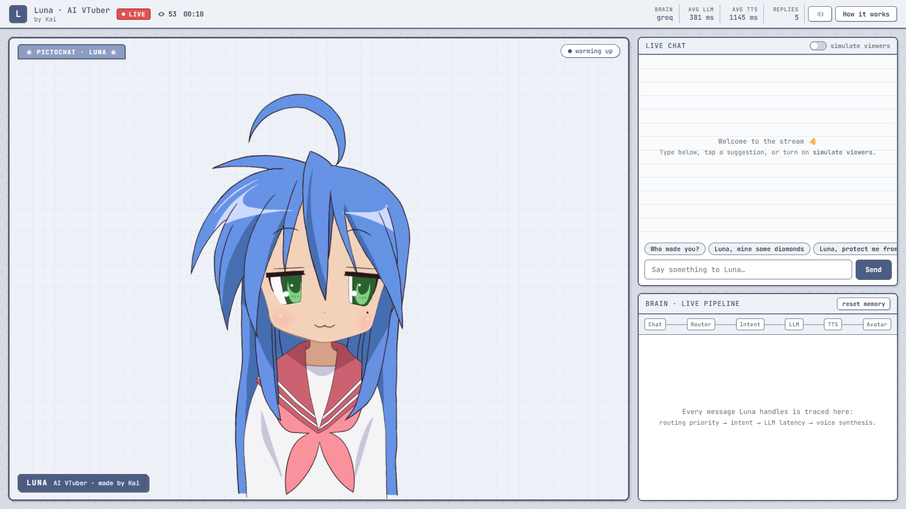
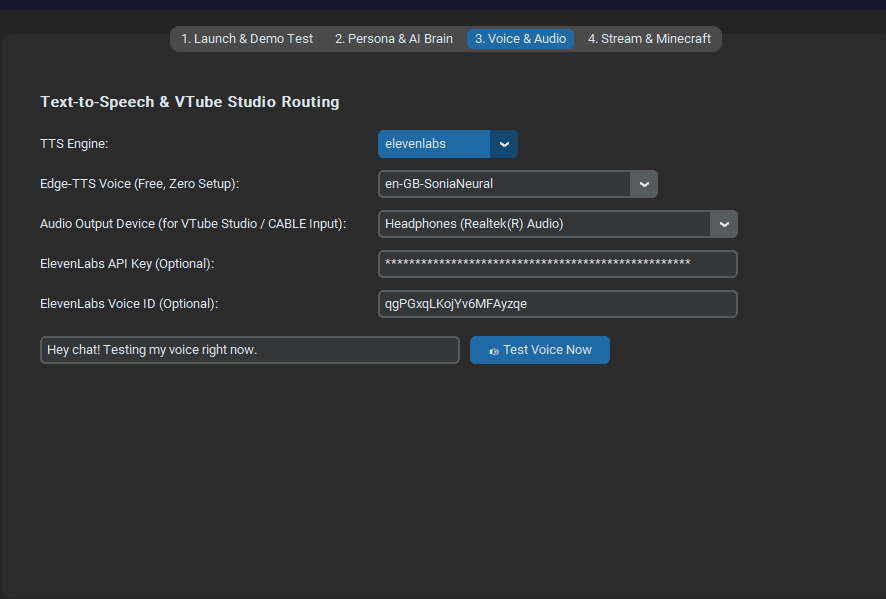

# Luna — Modular AI VTuber & Multi-Platform Agent

An event-driven, real-time AI companion and streamer built in Python (`asyncio`). Luna separates her **Core Brain** (`luna/`) from her **Platforms / Bodies** (`platforms/`), allowing the exact same personality, memory, and neural voice engine to drive a Live2D web stage, VRChat avatar, Desktop Studio, Twitch/TikTok stream, or Minecraft bot.

---

## Project Structure

```text
AI_VirtualYoutuber/
├── luna/                         # CORE BRAIN (Reusable anywhere)
│   ├── __init__.py               # Exports AIHandler, VoiceHandler, persona config
│   ├── brain.py                  # LLM client (Groq ⇄ Ollama failover) & rolling memory
│   ├── voice.py                  # Neural TTS (Edge-TTS / ElevenLabs / GPT-SoVITS)
│   ├── filter.py                 # Output moderation & TTS sanitization
│   ├── persona.json              # Customizable character bio & system rules
│   └── core/                     # StreamDirector, Priority+TTL SpeechQueue, Intent Router
│
├── platforms/                    # BODIES & INTEGRATIONS (Each powered by luna/)
│   ├── vrchat/                   # VRChat OSC chatbox (/chatbox/input) + Virtual Mic bridge
│   ├── web_stage/                # Browser Live2D avatar stage + real-time WebAudio lip-sync
│   ├── desktop_studio/           # CustomTkinter desktop control center & PyInstaller spec
│   ├── minecraft/                # Autonomous Mineflayer Node.js bot & HTTP controller
│   ├── live_stream/              # Full Twitch + TikTok + Mic stream director
│   └── vercel_chat/              # Standalone serverless web chatbot export
│
├── scripts/                      # CLI utilities
│   ├── chat.py                   # Fast terminal text/voice chat loop
│   └── test_chat.py              # Interactive model & audio device tester
│
├── start_demo.bat                # 1-click Browser Live2D Showcase
├── start_studio.bat              # 1-click Desktop Studio GUI
├── start_vrchat.bat              # 1-click VRChat OSC & Voice Bridge
├── .env.example
└── requirements.txt
```

### Reusing Luna's Brain in Any Script

```python
from luna import AIHandler, VoiceHandler

ai = AIHandler()
voice = VoiceHandler()

reply = ai.generate_response("What tech stack are you built on?", platform="Console", username="Kai")
print("Luna:", reply)
```

---

## Visual Showcase

### 1. Interactive Browser Stage & Live2D Demo
A self-contained browser showcase with real-time WebGL Live2D avatar animation, audio-driven RMS lip-sync, and a PictoChat-inspired live chat interface.



### 2. AI VTuber Studio Desktop App
A lightweight desktop control center (`CustomTkinter`) allowing you to customize VTuber personality, switch AI models (Groq / Ollama), configure voice routing (Edge-TTS / ElevenLabs / Virtual Audio Cable), test speech in a built-in sandbox, and launch services with one click.



---

## Running Modes

| Mode | One-Click Launcher | Command | Description |
| :--- | :--- | :--- | :--- |
| **Browser Live2D Stage** | `start_demo.bat` | `python platforms/web_stage/server.py` | Full visual stage + Live2D avatar + real-time lip-sync in your browser at `http://localhost:8000`. |
| **Desktop Studio App** | `start_studio.bat` | `python platforms/desktop_studio/app.py` | All-in-one GUI to customize persona, voice, audio cable, API keys, and launch services. |
| **VRChat Mode** | `start_vrchat.bat` | `python platforms/vrchat/vrchat_luna.py` | Connects Luna to VRChat via native OSC (`/chatbox/input`) + VB-Cable virtual microphone for automatic avatar lip-sync. |
| **Full Stream Director** | — | `python platforms/live_stream/main.py` | Connects to Twitch, TikTok, Mic, VTube Studio audio cable, and the Minecraft bridge. |
| **Minecraft Standalone** | — | `python platforms/minecraft/play_minecraft.py` | Launches the Node.js Mineflayer bridge and autonomous Minecraft companion loop. |
| **Terminal Chat** | — | `python scripts/chat.py` | Lightweight CLI loop for testing prompts and persona responses (`--voice` optional). |

---

## Using Luna in VRChat

Luna connects to VRChat with **zero game mods** using VRChat's built-in OSC protocol and a virtual audio cable:

1. **Enable OSC in VRChat:** Open the in-game Action Menu (`R` on desktop) → **Options** → **OSC** → **Enabled**.
2. **Set VRChat Microphone (for Voice & Auto Lip-Sync):**
   - Install [VB-Audio Virtual Cable](https://vb-audio.com/Cable/).
   - In VRChat Audio Settings, set your Microphone to **`CABLE Output (VB-Audio Virtual Cable)`**.
   - Luna automatically routes her TTS voice into **`CABLE Input`**, causing your VRChat avatar's mouth visemes to animate in real time.
3. **Launch Luna for VRChat:**
   ```bash
   start_vrchat.bat
   # Or with live microphone speech-to-text listening:
   python platforms/vrchat/vrchat_luna.py --listen
   ```

---

## Key Engineering Highlights

- **Modular Brain Package ([`luna/`](luna/)):** Clean separation between core cognition/voice (`luna/brain.py`, `luna/voice.py`) and platform adapters (`platforms/`).
- **Priority + TTL Speech Queue ([`luna/core/speech_queue.py`](luna/core/speech_queue.py)):** Prevents audio overlap and stale responses. Critical events (`P0`) and direct mentions (`P1`) jump ahead of background chat batches (`P3`) and idle banter (`P4`). Expired messages drop automatically via Time-To-Live (`ttl`).
- **Zero-Latency Intent Detection ([`luna/core/intent.py`](luna/core/intent.py)):** Extracts 20+ game commands in `<1 ms` using compiled regex patterns.
- **Automatic LLM Failover ([`luna/brain.py`](luna/brain.py)):** Seamlessly switches between cloud inference (`Groq`) and local inference (`Ollama`), with a scripted offline fallback so demos never crash.
